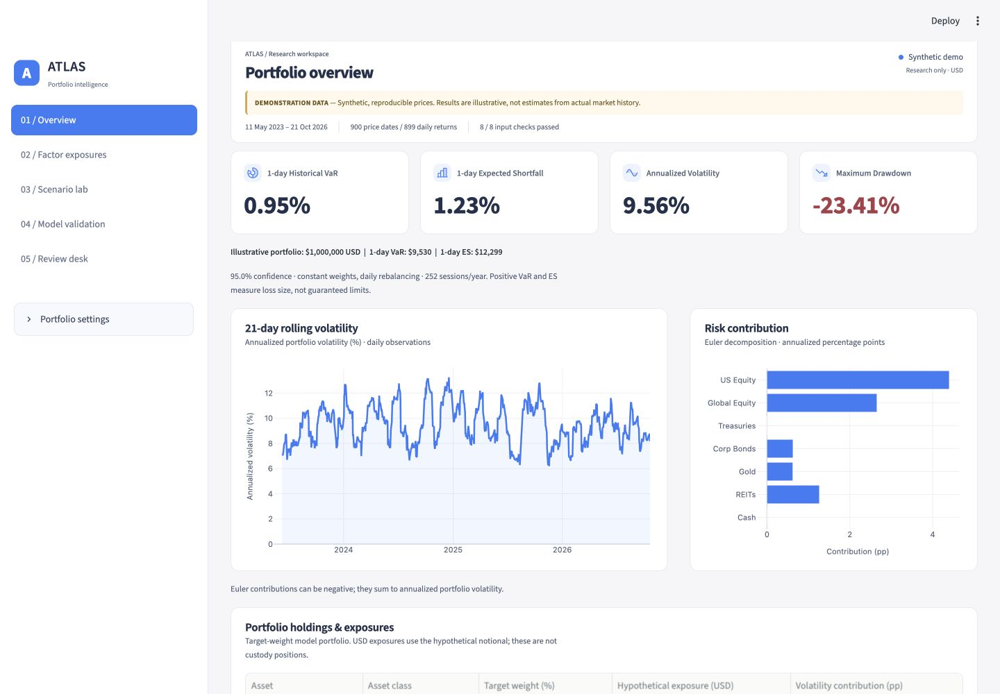
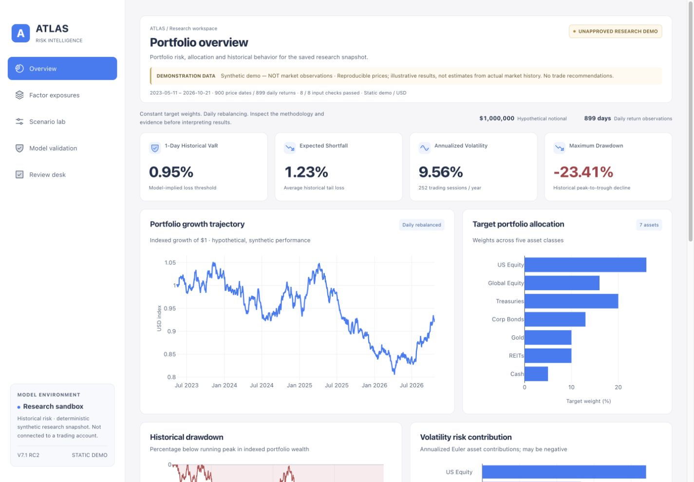
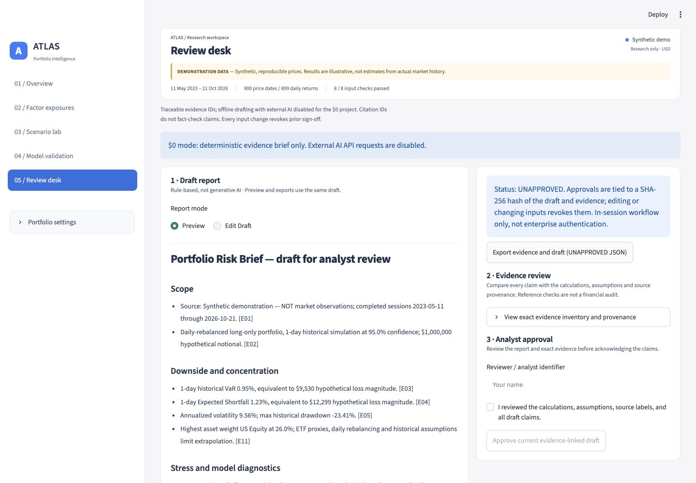
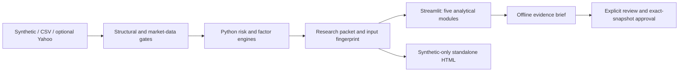

# ATLAS V7.1 RC2 · Portfolio Risk Intelligence

**An inspectable portfolio-risk workbench: from daily returns to evidence-linked analyst review.**

Python · Streamlit · Plotly · Reproducible offline HTML · MIT · $0 operating requirement

ATLAS connects cross-asset risk analytics, transparent model diagnostics and an
explicit human-review workflow. It demonstrates quantitative reasoning and software
engineering through seven model assets, five asset classes and five focused modules.

**The public demo is entirely synthetic.** ATLAS is a research prototype, not
investment advice, a trading platform, regulatory capital software or a verified
investment track record. The current public demo is [available on GitHub Pages](https://emmascq-ship-it.github.io/atlas-portfolio-risk/). The public static release is **V7.1 RC2**, with the approved light design across all five modules.



## RC2 static visual alignment

The static demo now shares the approved light Streamlit design. It remains a fixed synthetic snapshot with scenario controls and downloads. Draft editing, human acknowledgment, approval and revocation belong to the full Streamlit application only. The final RC2 normal-Terminal preflight passed all 134 Python tests, V6/V7 Chromium suites, 20 responsive module/viewport checks and full Streamlit E2E.



## Explore the workflow

| Module | What it shows |
|---|---|
| Overview | Historical VaR, Expected Shortfall, volatility, drawdown, risk contributions and holdings |
| Factor Exposures | Descriptive OLS betas, fitted variance attribution and cross-asset correlations |
| Scenario Lab | Explicit class shocks, asset attribution, hypothetical USD P&L and preset comparisons |
| Model Validation | Matched-window Historical/Gaussian VaR forecasts, rolling backtests and exception diagnostics |
| Review Desk | Read-only report preview, separate Edit Draft mode, evidence inventory and explicit analyst sign-off |

CSV/JSON/Markdown exports retain the applicable source metadata and exact numerical
snapshot. The Streamlit approval workflow binds SHA-256 hashes to the exact draft
and evidence; changing inputs or text revokes approval. Evidence-reference checks
verify IDs, **not the truth of financial claims**. Briefing is deterministic and
offline; external AI requests are disabled.



[Mobile Overview](assets/screenshots/overview-mobile.jpg) ·
[Mobile Review Desk](assets/screenshots/review-mobile.jpg) ·
[Factors](assets/screenshots/factors-desktop.jpg) ·
[Scenarios](assets/screenshots/scenario-desktop.jpg) ·
[Validation](assets/screenshots/validation-desktop.jpg)

Screenshots are actual local Streamlit captures of the frozen UI, using synthetic
data. The standalone HTML is a separate offline presentation of the same research
snapshot; it does not run Python or provide authenticated analyst approvals.

## Architecture



| Boundary | Implementation |
|---|---|
| Financial calculations | risk_engine.py, factor_engine.py, model_benchmark.py, validation_extensions.py |
| UI and chart presentation | app.py, ui_style.py, overview_style.py, module_style.py |
| Reproducible exports and review | research_packet.py, briefing_workflow.py |
| Optional private market ingestion | market_data.py, market_integrity.py, tiingo_reference.py |
| Offline demo build | static_dashboard.py, publish_demo.py, templates/ and assets/ |
| Release gates | release_preflight.py, public_audit.py, tests/ |

## Run locally

Use **Python 3.12** (validated with 3.12.2). From the repository root:

```bash
python3.12 -m venv .venv
source .venv/bin/activate
python -m pip install -r requirements.txt
python -m streamlit run app.py --browser.gatherUsageStats false
```

On Windows activate with `.venv\Scripts\Activate.ps1`. Synthetic mode needs no
API key. Runtime and test versions, including Plotly, are pinned and constrained
by requirements.lock. No paid API, subscription, trial or model runner is required.

To build and inspect the synthetic standalone demo locally:

```bash
python publish_demo.py
python public_audit.py
python -m http.server 8000 --directory docs --bind 127.0.0.1
```

Open http://127.0.0.1:8000. The shipped docs/index.html also opens offline; it
contains its chart runtime and seeded synthetic snapshot without a market API/CDN.
Its scenario controls update hypothetical P&L only, not the archived VaR history.

For optional local CSV analysis, supply Date plus US Equity, Global Equity,
Treasuries, Corp Bonds, Gold, REITs and Cash. Dates must be unique/ordered and
prices positive, finite and complete. Do not commit confidential inputs or exports.
Uploads reach the Streamlit server; this prototype has no enterprise authentication.

## Methodology

The default USD 1 million model portfolio uses 900 seeded price dates and constant
long-only weights, with daily rebalancing. Historical VaR/ES describe the empirical
return tail; Gaussian VaR uses sample mean and standard deviation. Volatility uses
252 sessions/year; drawdown is measured against the wealth high-water mark.
Rolling forecasts use only preceding observations, with matched windows for the
two VaR methods. OLS ETF-spread exposures are descriptive and in-sample.

The documented default stress is **−13.045%**, or **−$130,450** on the hypothetical
notional. This is a deterministic scenario assumption, not realized performance.
The unsupported older 12.5% figure is not claimed.

[Detailed methodology and validation](METHODOLOGY_VALIDATION.md) explains units,
quantiles, no-look-ahead testing, factor assumptions and forecast-window differences.

## Verification and release candidate

**ATLAS V7.1 RC2:** current models and UI are frozen by RELEASE_FREEZE_SHA256.txt.
The saved normal-Mac-Terminal RC2 log confirms a complete preflight pass: **134
Python tests, V6/V7 Chromium suites and the full Streamlit E2E**, including approval,
revocation, exports, mobile layouts and JavaScript checks. Offline synthetic
build checks also passed. The exact corrected synthetic HTML was matched to the successful log. The agent
sandbox's Chromium launch restriction is recorded separately, not an open product
failure. See [verification report](VERIFICATION_REPORT.md) for attribution/scope.

```bash
python -m pip install -r requirements-test.txt
python -m playwright install chromium
python release_preflight.py --browser
```

On Linux, Playwright may require system libraries via
`python -m playwright install --with-deps chromium`. Two previously fresh pinned
installations produced matching HTML; cross-platform/BLAS byte identity is not
claimed. The public-only validation workflow has read-only permissions and no
deployment step. Current remote results are available in [GitHub Actions](https://github.com/emmascq-ship-it/atlas-portfolio-risk/actions); Pages has its own build/deployment workflow.

## Limitations and data boundaries

- Synthetic results are illustrative, not market observations or model performance.
- No liquidity horizon, slippage, nonlinear instruments or regulatory-capital claims.
  VaR is not a guaranteed loss bound; sparse-tail coverage tests have limited power.
- Factor proxies share ETFs and may be collinear; exposures are not causal estimates.
- Optional Yahoo/yfinance errors stop visibly, with no synthetic fallback. Independent
  Tiingo validation is optional and PENDING without usable genuinely free access.
  Provider self-consistency does not equal independent verification.
- Provider-licensed prices/private portfolios must not enter the public demo or Git
  history. Public docs/ contains only the audited synthetic index.html and .nojekyll.
- Approval is session-local attestation, not authenticated identity or durable governance.

## Portfolio and publication

- [90-second interview walkthrough](DEMO_WALKTHROUGH.md)
- [LinkedIn Featured copy](PORTFOLIO_COPY.md)
- [Exact GitHub/Pages publication steps](DEPLOYMENT_CHECKLIST.md)
- [Release audit and scope](RELEASE_CANDIDATE.md)

GitHub Pages serves only the synthetic static demo; Streamlit hosting is a separate
optional decision and is not hosted for this release. RC2 is published to the existing
[public repository](https://github.com/emmascq-ship-it/atlas-portfolio-risk) on `main`;
Pages serves `/docs` at the [existing free demo URL](https://emmascq-ship-it.github.io/atlas-portfolio-risk/).
No paid plan, domain or external service is used.

## License and attribution

ATLAS code: [MIT](LICENSE). [Third-party notices](THIRD_PARTY_NOTICES.md) retain
Phosphor Duotone, Plotly and Cloud Finance layout-reference attribution. No reference
artwork or Flutter application is redistributed.
